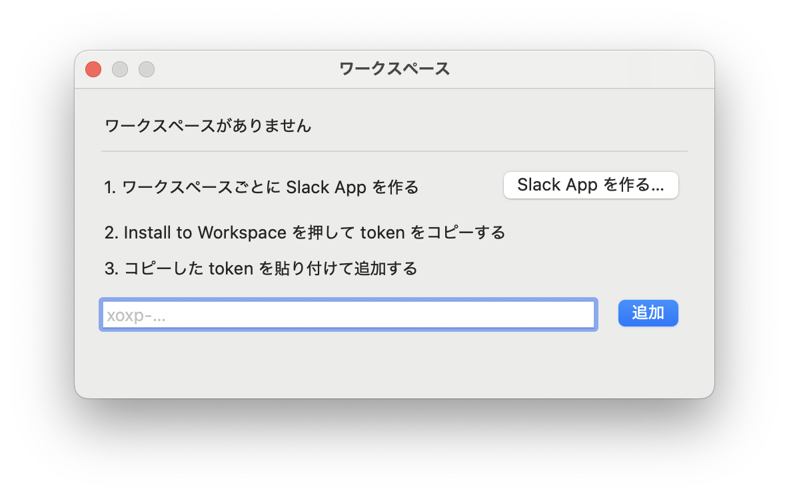
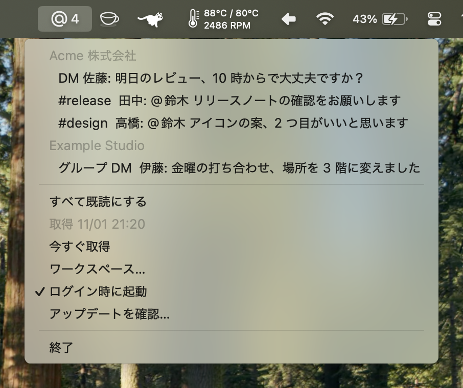

# atme

[English](README.md)

自分宛の Slack を見落とさないための、macOS のメニューバーアプリです。自分へのメンションと DM を、メニューバーの一覧と通知で知らせます。@here、@channel、ユーザーグループへのメンションは拾わず、自分個人に向けられたものだけを拾います。

## 特徴

- 拾ったメッセージは、Slack で既読にするまで一覧に残ります。
- 複数のワークスペースを、ワークスペースごとに分けて一つのメニューで見られます。
- token は Keychain にだけ保存します。通信する先は、Slack の API と更新の確認だけです。

## 動作環境

- macOS 13 以降
- Apple シリコンの Mac
- 自分で Slack App を作れる Slack のワークスペース

## インストール

[リリース](https://github.com/dominion525/atme/releases)から `atme-<version>.zip` をダウンロードして展開し、`atme.app` を「アプリケーション」フォルダに移して開きます。アプリは Developer ID で署名し、公証しています。

初めて開いたときに通知の許可を求められるので、許可します。

## ワークスペースを追加する

atme は、ワークスペースごとに作った Slack App の user token で Slack を読みます。Slack App は、作ったワークスペースにしかインストールできないためです。

ワークスペースが一つも無いときは、起動すると「ワークスペース」のウインドウが開きます。二つ目以降は、メニューの「ワークスペース…」から開きます。ウインドウの手順に沿って進めます。



1. 「Slack App を作る…」を押し、ブラウザで開いた Slack の画面でワークスペースを選んで、Slack App を作ります。
2. Slack の画面で Install to Workspace を押し、表示された User OAuth Token をコピーします。
3. コピーした token をウインドウに貼り付け、「追加」を押します。

Slack App の名前と権限は、[slack-app-manifest.json](slack-app-manifest.json) の内容で設定されます。ワークスペースの管理者がアプリの作成やインストールを制限している場合は、管理者の承認が必要です。

ワークスペースを外すときは、ウインドウの一覧で「削除」を押します。token も Keychain から消えます。

## 使い方



atme はメニューバーに「@」のアイコンを置き、Dock には現れません。アイコンの横の数字は、未読のメンションと DM の件数です。

メニューには、未読のメッセージがワークスペースごとに新しい順に並びます。項目を選ぶと、そのメッセージを Slack で開き、atme の一覧から外します。「すべて既読にする」は、今の一覧をまとめて外します。どちらも、Slack 側の既読の状態は変えません。

取得は 5 分ごとと、スリープから戻ったときに行います。すぐに取得したいときは「今すぐ取得」を選びます。新しく見つかったメッセージは通知で届き、通知を押すとそのメッセージを Slack で開きます。

ログインしたときに起動させるには、メニューの「ログイン時に起動」をオンにします。

## 拾うメッセージ

| 拾うもの                       | 拾わないもの                                    |
| ------------------------------ | ----------------------------------------------- |
| 自分へのメンション             | @here、@channel、ユーザーグループへのメンション |
| DM とグループ DM               | 自分が送ったメッセージ                          |
| フォローしているスレッドの返信 | フォローしていないスレッドの返信                |
|                                | アーカイブされたチャンネルのメッセージ          |

既読かどうかは、Slack の既読の位置で判断します。Slack でメッセージを読むと、次の取得で atme の一覧からも消えます。

## プライバシーと権限

token は Keychain にだけ保存し、設定ファイルには書きません。atme が通信するのは、Slack の API（`slack.com`）と、新しい版の確認（[Sparkle](https://sparkle-project.org)）だけです。新しい版の確認では更新の一覧を取得するだけで、Mac の情報は送りません。自動で確認してよいかは、2 回目に起動したときに尋ねられます。

Slack App が求める user token のスコープは、次の 10 個です。

| スコープ                                                           | 使う API                | 用途                       |
| ------------------------------------------------------------------ | ----------------------- | -------------------------- |
| `search:read`                                                      | `search.messages`       | メンションと DM を探す     |
| `users:read`                                                       | `users.info`            | 送り主の表示名を引く       |
| `channels:read`、`groups:read`、`im:read`、`mpim:read`             | `conversations.info`    | 会話の既読の位置を読む     |
| `channels:history`、`groups:history`、`im:history`、`mpim:history` | `conversations.replies` | スレッドの既読の位置を読む |

## 設定ファイル

設定は `~/.config/atme/config.toml` にあります。ワークスペースの追加と削除はウインドウから行えるので、手で書く必要はありません。

```toml
# さかのぼって探す日数（既定は 7）
days = 7

[[workspace]]
name = "acme"
```

`name` は、ウインドウから追加したときはワークスペースの URL のサブドメインになります。手で書いたコメントは、ウインドウから追加や削除をしても残ります。

## ソースからビルドする

Rust と rsvg-convert（`brew install librsvg`）が必要です。

```
script/bundle
open target/release/atme.app
```

`script/bundle` は `target/release/atme.app` を作り、ad-hoc で署名します。証明書で署名するときは、`ATME_SIGN_IDENTITY` に証明書の名前を入れます。

テストは `cargo test` で動かします。macOS の Foundation を使うテストがあるので、macOS で動かします。

リリースの手順は [docs/releasing.md](docs/releasing.md) にあります。

## ライセンス

[MIT License](LICENSE)

アイコンの「@」は、[Comfortaa](https://github.com/alexeiva/comfortaa)（SIL Open Font License 1.1）の字形から作っています。詳しくは [assets/README.md](assets/README.md) にあります。
