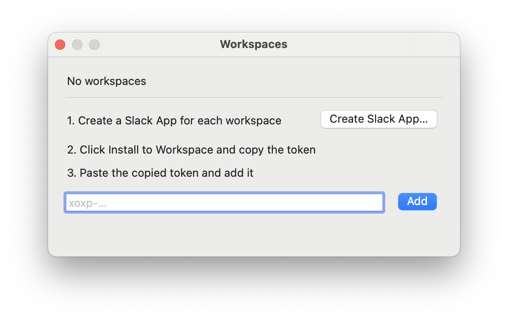
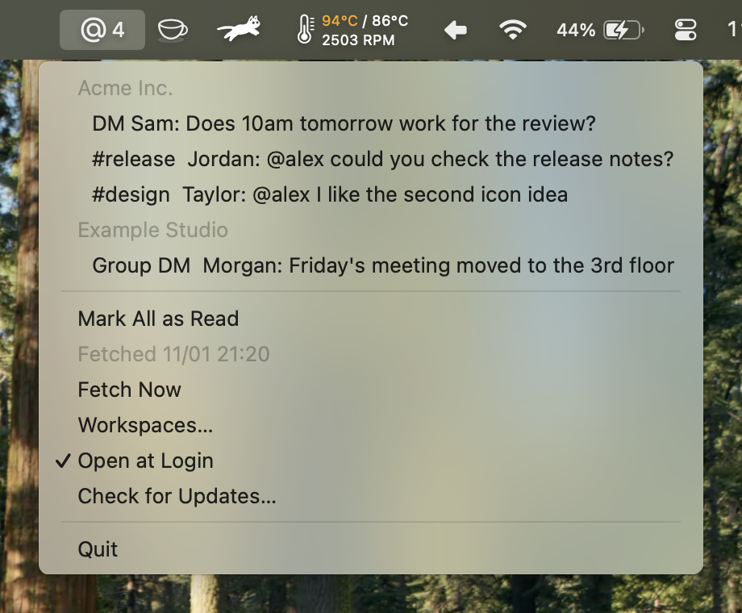

# atme

[日本語](README.ja.md)

atme is a macOS menu bar app that keeps you from missing Slack messages addressed to you.
It shows your mentions and DMs in a list in the menu bar and as notifications.
It leaves out mentions of @here, @channel, and user groups, and shows only messages meant for you personally.

## Features

- Messages stay in the list until you read them in Slack.
- Messages from several workspaces appear in one menu, grouped by workspace.
- Tokens are stored only in the Keychain. atme connects only to the Slack API and to the update check and download.

## Requirements

- macOS 13 or later
- A Mac with Apple silicon
- A Slack workspace where you can create a Slack App

## Installation

If you use Homebrew, install atme with:

```
brew install --cask dominion525/tap/atme
```

Because the name includes the tap, Homebrew adds the tap at the same time and trusts only the atme cask in it.

If you don't use Homebrew, download `atme-<version>.zip` from the [releases](https://github.com/dominion525/atme/releases), unzip it, move `atme.app` to the Applications folder, and open it.

Either way, the app is signed with a Developer ID and notarized by Apple.
Once installed, atme updates itself.
To check for a new version right away, choose Check for Updates… in the menu.

On first launch, atme asks for permission to send notifications. Allow it.

## Adding a workspace

atme reads Slack messages with the user token of a Slack App.
A Slack App can only be installed in the workspace it was created in, so you create one for each workspace.

On first launch there is no workspace yet, so the Workspaces window opens by itself.
To add another workspace later, open the window with Workspaces… in the menu.
Then follow the steps shown in the window:



1. Click Create Slack App…, choose the workspace on the Slack page that opens in your browser, and create the Slack App.
2. On the Slack page, click Install to Workspace and copy the User OAuth Token that is shown.
3. Paste the token into the window and click Add.

The app's name and permissions are set from [slack-app-manifest.json](slack-app-manifest.json).
If the workspace admins restrict creating or installing apps, you need their approval.

To remove a workspace, click Remove next to it in the window.
Its token is deleted from the Keychain as well.

## Usage



atme stays in the menu bar as an @ icon and does not appear in the Dock.
The number next to the icon is the count of unread mentions and DMs.

The menu lists unread messages by workspace, newest first.
Choosing an item opens the message in Slack and removes it from atme's list.
Mark All as Read removes the whole current list.
Neither changes the read state in Slack.

atme fetches new messages every 5 minutes and when the Mac wakes from sleep.
To fetch right away, choose Fetch Now.
When new messages are found, a notification arrives; clicking it opens the message in Slack.

To start atme when you log in, turn on Open at Login in the menu.

## Which messages atme picks up

| Picked up                     | Not picked up                                |
| ----------------------------- | -------------------------------------------- |
| Mentions of you               | Mentions of @here, @channel, and user groups |
| DMs and group DMs             | Messages you sent                            |
| Replies in threads you follow | Replies in threads you don't follow          |
|                               | Messages in archived channels                |

Whether a message is read follows Slack's read position.
Once you read a message in Slack, it disappears from atme on the next fetch.

## Privacy and permissions

Tokens are stored only in the Keychain and are never written to the settings file.
atme connects only to the Slack API (`slack.com`) and to the update check and download by [Sparkle](https://sparkle-project.org).
The update check only fetches the list of new versions and sends no information about your Mac.
On its second launch, atme asks whether to check for updates automatically.

The Slack App asks for these 10 user token scopes:

| Scope                                                              | API                     | Purpose                                 |
| ------------------------------------------------------------------ | ----------------------- | --------------------------------------- |
| `search:read`                                                      | `search.messages`       | Find mentions and DMs                   |
| `users:read`                                                       | `users.info`            | Look up sender names                    |
| `channels:read`, `groups:read`, `im:read`, `mpim:read`             | `conversations.info`    | Read the read position of conversations |
| `channels:history`, `groups:history`, `im:history`, `mpim:history` | `conversations.replies` | Read the read position of threads       |

## Settings file

Settings are in `~/.config/atme/config.toml`.
Workspaces are added and removed from the window, so you don't need to edit it by hand.

```toml
# Days to search back (7 by default)
days = 7

[[workspace]]
name = "acme"
```

For a workspace added from the window, `name` is the subdomain of its URL.
Comments you write by hand are kept when workspaces are added or removed from the window.

## Building from source

You need Rust and rsvg-convert (`brew install librsvg`).

```
script/bundle
open target/release/atme.app
```

`script/bundle` creates `target/release/atme.app` and signs it ad hoc.
To sign with a certificate, set `ATME_SIGN_IDENTITY` to the certificate name.

Run the tests with `cargo test`.
Some tests use macOS Foundation, so run them on macOS.

The release steps are in [docs/releasing.md](docs/releasing.md).

## License

[MIT License](LICENSE)

The @ in the icon is made from a glyph of [Comfortaa](https://github.com/alexeiva/comfortaa) (SIL Open Font License 1.1).
See [assets/README.md](assets/README.md) for details.
